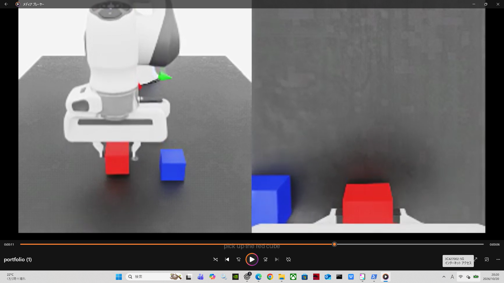

# Language-Conditioned Cube Picking with Isaac Lab

<table>
  <tr>
    <td align="center">
      
      <br><b> pick up the red cube </b>
    </td>
    <td align="center">
      
      <br><b> pick up the blue cube </b>
    </td>
  </tr>
</table>

**赤・青のCubeを言語指示で選び、把持して3秒間保持するVLAデモ。**

`pick up the red cube` / `pick up the blue cube`

テーブルカメラ・手首カメラの画像、ロボット状態、言語指示を入力し、学習したモデルが逐次動作を出力します。評価時に教師制御への切替や動作上書きは行っていません。

## Demo videos

各動画はテーブルカメラ（左）と手首カメラ（右）を表示します。下部の英文がその試行の指示です。4象限は基準配置からのXYオフセットで、単位はmmです。

| 象限 | X / Y | 赤Cubeを指定 | 青Cubeを指定 |
|---|---|---|---|
| I | +20 / +20 | [動画](videos/q1_red.mp4) | [動画](videos/q1_blue.mp4) |
| II | −20 / +20 | [動画](videos/q2_red.mp4) | [動画](videos/q2_blue.mp4) |
| III | −20 / −20 | [動画](videos/q3_red.mp4) | [動画](videos/q3_blue.mp4) |
| IV | +20 / −20 | [動画](videos/q4_red.mp4) | [動画](videos/q4_blue.mp4) |

動画8本は固定の色配置で指示を変えたデモです。別途、色の配置を入れ替えた条件も評価しています。

## Evaluation

**±20 mmの軸方向4位置・対角方向4位置 × 色配置2通り × 指示2通り = 32/32成功。** 動画収録でも8/8成功しました。

- 指定色のCubeを持ち上げ、連続3秒間保持。
- 指定外Cubeの持ち上げ・移動も判定。
- 学習モデルのみで制御し、各ステップで言語・動作推論を実行。
- 位置オフセットは2個のCubeを一緒に平行移動する設定です。Cube間隔は120 mmです。

結果は [32条件の記録](results/range20_results.json) と [動画収録結果](results/video_results.json) に保存しています。

## Method and recovery

画像特徴抽出器を固定し、言語・ロボット状態と統合するモデルおよび再帰型動作デコーダを学習しました。モデル入力にCubeのシミュレータ座標や進行段階は含めません。教師データ生成と評価判定にはシミュレータ情報を使用します。

通常の教師軌道追加だけでは一部条件が悪化しました。そこで失敗記録を500ステップ再生し、その状態から教師が位置を合わせ直す565ステップの修正動作を収集しました。再生部分は再帰モデルの履歴に使い、教師の正解動作から除外しています。

最終学習は46エピソード、検証は4エピソードです。採用モデルは検証損失だけでなく、シミュレーションで32条件のpick・保持成功を確認しています。

## Scope and limitations

- 32試行は選定した固定条件の結果です。±20 mm内のあらゆる連続位置や、繰り返し試行での成功率を保証しません。
- 学習・修正に使用した位置を含む回帰評価です。独立した未知位置テストではありません。
- ±30 mmでは21/32成功でした。今回は改善対象から外し、公開成果の範囲を±20 mmに限定しています。
- 成功判定は高さ・手先との近接・保持時間等によるもので、接触力による把持検証は行っていません。
- シミュレーションの成果であり、実機での検証は行っていません。

## Files and environment

- `videos/`: テロップ付きMP4動画8本
- `results/`: 評価・学習・監査結果
- `model/`: 採用チェックポイントとモデル定義
- `code/`: 学習・評価・収録スクリプト
- `SHA256SUMS.json`: 公開ファイルのSHA256一覧
- `history/isaac-lab-vla-cube-lift_3/`: 前版ポートフォリオ（公開時に移動）

実行環境：NVIDIA RTX 4090、PyTorch 2.11.0+cu128、torchvision 0.26.0+cu128、NumPy 2.5.4、Gymnasium 1.2.1、Isaac Sim / Isaac Lab。

**実行コードは元のRunPod環境のスナップショットです。** `/workspace/step4`等の既存データ・ランタイム・アセットへの参照があり、このリポジトリ単独での再実行は未検証です。全教師画像データ・Isaac Sim本体・外部アセットは同梱していません。

チェックポイントSHA256：`20b61d3e9167321aeb5f72e1fd9fecf32f7afd080d5510fa4f6b5fd7e37d3d11`

## モデルの復元

GitHub APIの送信サイズ制限に対応するため、採用モデルは8 MiB以下の分割ファイルとして保存しています。ダウンロード・展開後、以下を実行すると各部分と全体のSHA256を検証し、`model/best.pt`を復元します。

```bash
python model/restore_checkpoint.py
```
