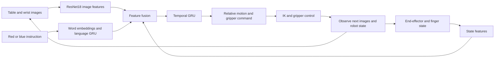

[日本語](README_JPN.md) | English | [Language selection](README.md)

# Isaac Lab：Identify colors based on verbal instructions and grasp the cube.

<table>
  <tr>
    <td align="center">
      
      <br><b> pick up the red cube </b>
    </td>
    <td align="center">
      
      <br><b> pick up the blue cube </b>
    </td>
  </tr>
</table>

**A VLA demonstration that selects a red or blue cube from a language instruction, picks it up, and holds it for three seconds.**

`pick up the red cube` / `pick up the blue cube`

The learned policy generates actions from table-camera and wrist-camera images, robot state, and a language instruction. Evaluation uses the learned policy without switching to teacher control or overriding its actions.

## Demo videos

Each video shows the table camera on the left and the wrist camera on the right. The caption at the bottom gives the instruction. XY offsets below are relative to the reference layout, in millimeters.

| Quadrant | X / Y (mm) | Red instruction | Blue instruction |
|---|---|---|---|
| I | +20 / +20 | [Video](result/evidence/videos/q1_red.mp4) | [Video](result/evidence/videos/q1_blue.mp4) |
| II | -20 / +20 | [Video](result/evidence/videos/q2_red.mp4) | [Video](result/evidence/videos/q2_blue.mp4) |
| III | -20 / -20 | [Video](result/evidence/videos/q3_red.mp4) | [Video](result/evidence/videos/q3_blue.mp4) |
| IV | +20 / -20 | [Video](result/evidence/videos/q4_red.mp4) | [Video](result/evidence/videos/q4_blue.mp4) |

These eight videos use a fixed color layout with both instructions. The evaluation also includes swapped color layouts. Additional portfolio images are available in [images](result/evidence/images/).

## VLA

### What is VLA?

**Vision–Language–Action (VLA) models combine visual information and language instructions to produce robot actions.** In this project, the robot observes a scene containing red and blue cubes and acts on one of the two instructions above.

### Inputs and outputs

| Component | Information and role |
|---|---|
| Vision | RGB images from the table and wrist cameras provide scene and close-up views. |
| Language | The instruction is tokenized into words and encoded using trainable embeddings and a language GRU. |
| Robot state | Nine values: end-effector position (3), quaternion orientation (4), and finger positions (2). |
| Action | Seven values: relative translation (3), relative rotation (3), and gripper opening/closing (1). Motion commands are passed to inverse kinematics (IK) control. |



### Learning and execution

This is a **small, task-specific, language-conditioned VLA architecture** for red/blue cube picking. Its supported instructions are the two phrases shown above.

Both camera streams share a ResNet18 image encoder, whose weights remain frozen during this training. Visual, language, and robot-state features are fused and passed to a temporal GRU that carries observation history forward. The language GRU and temporal GRU are separate modules.

Training uses **behavioral cloning** from pre-action observations, language instructions, and teacher actions. Recovery training adds teacher corrections following observation histories replayed from a failed rollout.

At evaluation time, the learned policy selects actions from the initial state and uses subsequent observations in a **closed loop**. Simulator cube poses and teacher progress are not model inputs. Simulator object information is used for teacher data generation and success evaluation.

Implementation: [Feature fusion](result/models/color_model.py) / [Temporal action decoder](result/models/color_temporal.py).

## Evaluation

**32/32 successful trials: eight offsets at ±20 mm (four axial and four diagonal), two color layouts, and two instructions.** Video recording also achieved 8/8 successful trials.

- Lift the instructed cube and hold it continuously for three seconds.
- Check lifting and displacement of the other cube.
- Run language and action inference at every step using the learned policy.
- Translate both cubes together for each offset; their spacing is 120 mm.

Records: [32-condition evaluation](result/evidence/range20_results.json) / [Video results](result/evidence/video_results.json).

## Method and recovery

The image encoder is frozen while the feature-fusion model and recurrent action decoder are trained. Simulator cube coordinates and task progress are excluded from policy inputs, but simulator information is used for teacher generation and evaluation.

Adding ordinary teacher trajectories alone caused regressions in some conditions. We therefore replayed 500 steps from a failed rollout and collected 565 steps of teacher correction from the resulting state. The replay prefix provides recurrent context and is excluded from supervised action targets.

The final split contains 46 training episodes and four validation episodes. Model selection is supported by closed-loop picking and holding results across the 32 conditions, rather than validation loss alone.

## Scope and limitations

- The 32 trials cover selected fixed conditions. They do not establish success at every continuous position within ±20 mm or reliability over repeated trials.
- This is regression evaluation that includes positions used for training and recovery, not an independent unseen-position test.
- Evaluation at ±30 mm achieved 21/32 successes. Further improvement at that range was deferred; this portfolio focuses on ±20 mm.
- Success uses height, proximity to the end effector, hold duration, and related checks. Grasp contact forces were not verified.
- Results are simulation-only; no physical-robot validation was performed.

## Files and environment

- `code/`: training, evaluation, data auditing, and recording scripts.
- `datasets/`: dataset documentation; the training HDF5 files are not included.
- `result/evidence/`: evaluation, training, and audit records.
- `result/evidence/videos/`: eight captioned MP4 videos.
- `result/evidence/images/`: portfolio images.
- `result/models/`: split checkpoint, restoration utility, and model definitions.
- `SHA256SUMS.json`: checksums for published files.
- `history/isaac-lab-vla-cube-lift_3/`: archived previous portfolio.

Environment: NVIDIA RTX 4090, PyTorch 2.11.0+cu128, torchvision 0.26.0+cu128, NumPy 2.5.4, Gymnasium 1.2.1, Isaac Sim, and Isaac Lab.

**The scripts are snapshots of the original RunPod environment.** They reference existing data, runtime packages, and assets under paths such as `/workspace/step4`. Standalone reproduction from this repository has not been verified. The complete teacher image dataset, Isaac Sim installation, and external assets are not included.

Checkpoint SHA256: `20b61d3e9167321aeb5f72e1fd9fecf32f7afd080d5510fa4f6b5fd7e37d3d11`

### Simulation platform

This project uses **NVIDIA Isaac Sim**, a robotics simulator built on **NVIDIA Omniverse**, and **NVIDIA Isaac Lab**, a robot-learning framework built on Isaac Sim. The virtual environment simulates robot/cube physics and camera images for teacher data collection and closed-loop evaluation of the learned VLA policy. Behavioral cloning is implemented using **PyTorch**.

Relationship: **NVIDIA Omniverse → NVIDIA Isaac Sim → NVIDIA Isaac Lab → this project's simulation environment**.

Official references: [Isaac Sim](https://developer.nvidia.com/isaac/sim/) / [Isaac Lab](https://developer.nvidia.com/isaac/lab).

### Directory structure

```text
README.md
README_JPN.md
README_ENG.md
code/
datasets/
    README.md
result/
    evidence/
        videos/
        images/
        (evaluation and training records)
    models/
history/
```

See [dataset documentation](datasets/README.md) for the data description and publication scope.

## Restoring the model

The checkpoint is split into parts no larger than 8 MiB to accommodate GitHub API upload constraints. After downloading and extracting the repository, run:

```bash
python result/models/restore_checkpoint.py
```

The utility verifies part and complete-checkpoint SHA256 hashes and restores `result/models/best.pt`.

## Summary and Future Challenges

### Achievements
We developed a Vision-Language-Action (VLA) model capable of selecting a red or blue cube based on a natural language instruction, grasping it, and holding it for three seconds. The model succeeded across 32 experimental conditions—encompassing various cube positions (along axes and diagonals, with a ±20 mm variance), color configurations, and specific instructions—and we have released eight demonstration videos covering four quadrants and two types of instructions. Furthermore, we improved the model’s performance through additional training that incorporated observation histories from failed attempts alongside corrective actions provided by a human supervisor.

### Remaining Challenges
Outstanding tasks include ensuring stability for previously unseen positions and across repeated trials, extending the operational range to ±30 mm, implementing grasp evaluation based on contact force, and conducting validation on physical hardware. Additionally, establishing full reproducibility—including the training data and execution environment—remains a challenge.
As we are shifting our focus to a different project, there are currently no plans to address these remaining issues.
