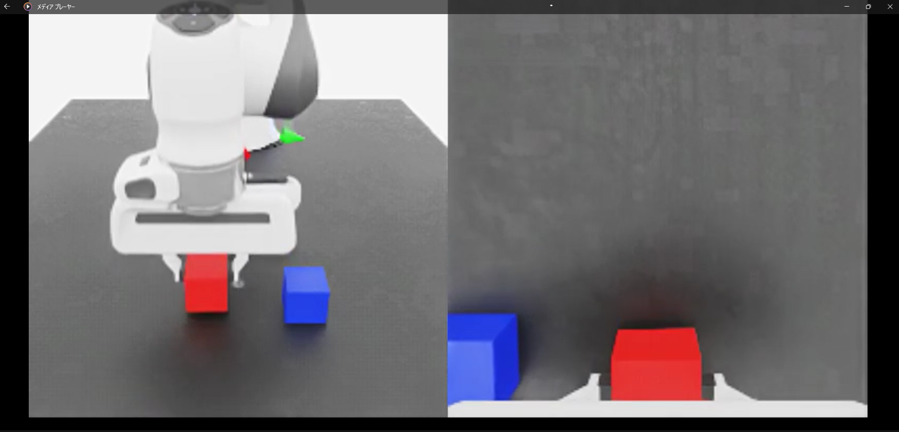
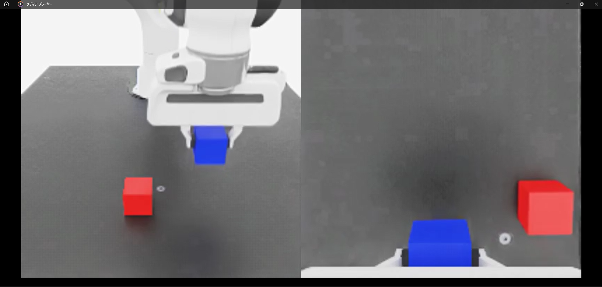
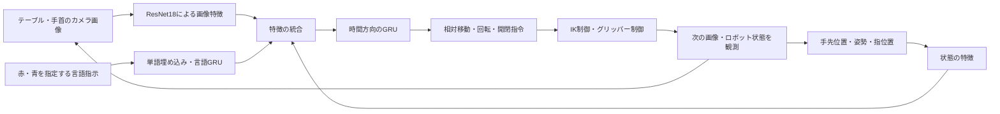

[English](README_ENG.md) | [言語選択 / Language selection](README.md)

# Language-Conditioned Cube Picking with Isaac Lab

<table>
  <tr>
    <td align="center">
      
      <br><b> pick up the red cube </b>
    </td>
    <td align="center">
      
      <br><b> pick up the blue cube </b>
    </td>
  </tr>
</table>

**赤・青のCubeを言語指示で選び、把持して3秒間保持するVLAデモ。**

`pick up the red cube` / `pick up the blue cube`

テーブルカメラ・手首カメラの画像、ロボット状態、言語指示を入力し、学習したモデルが逐次動作を出力します。評価時に教師制御への切替や動作上書きは行っていません。

## Demo videos

各動画はテーブルカメラ（左）と手首カメラ（右）を表示します。下部の英文がその試行の指示です。4象限は基準配置からのXYオフセットで、単位はmmです。

| 象限 | X / Y | 赤Cubeを指定 | 青Cubeを指定 |
|---|---|---|---|
| I | +20 / +20 | [動画](result/evidence/videos/q1_red.mp4) | [動画](result/evidence/videos/q1_blue.mp4) |
| II | −20 / +20 | [動画](result/evidence/videos/q2_red.mp4) | [動画](result/evidence/videos/q2_blue.mp4) |
| III | −20 / −20 | [動画](result/evidence/videos/q3_red.mp4) | [動画](result/evidence/videos/q3_blue.mp4) |
| IV | +20 / −20 | [動画](result/evidence/videos/q4_red.mp4) | [動画](result/evidence/videos/q4_blue.mp4) |

動画8本は固定の色配置で指示を変えたデモです。別途、色の配置を入れ替えた条件も評価しています。

## VLA

**VLA（Vision–Language–Action）は、画像から得た情報（Vision）と、言語による指示（Language）を組み合わせて、ロボットの動作（Action）を生成するモデルです。**

このプロジェクトでは、同じ場面に赤・青のCubeがある状態で、`pick up the red cube` または `pick up the blue cube` を入力します。ロボットはカメラ画像と自身の状態を観測し、指定されたCubeへ接近して把持・持ち上げを行います。

### このプロジェクトの入力と出力

| 要素 | 使用する情報・役割 |
|---|---|
| **Vision：見る** | テーブルカメラと手首カメラのRGB画像。2つの視点から場面と手先付近の情報を取得します。 |
| **Language：指示を受け取る** | 赤または青のCubeを指定する英文。単語をトークン化し、学習可能な埋め込みとGRUで特徴へ変換します。 |
| **ロボット状態** | 手先位置3成分・姿勢4成分・左右の指位置2成分の計9成分。現在の手先の状態をモデルへ入力します。 |
| **Action：動かす** | 手先の相対移動3成分・相対回転3成分・グリッパー開閉の計7成分。移動・回転指令を逆運動学（IK）制御へ渡します。 |



### 動作を学ぶ仕組み

本実装は、**赤・青のCube把持に対象を絞った、言語条件付きの小規模なVLA構成**です。対応する指示文は上記2種類です。

画像特徴は2台のカメラで共有するResNet18から取得し、今回の学習ではその重みを固定しています。画像・言語・ロボット状態の特徴を統合した後、時間方向のGRUが過去の観測を引き継ぎながら次の動作を出力します。言語を符号化するGRUと、観測履歴を扱う時間方向のGRUは別のモジュールです。

学習には、教師が動かしたときの「動作前の観測・言語指示・正解動作」を使う**模倣学習（Behavioral Cloning）**を用いました。さらに、失敗直前の観測履歴に続けて、教師が位置を合わせ直す修正動作を追加しています。

評価時は初期状態から学習モデル自身が動作を選び、動作後の観測を次の推論へ戻す**閉ループ制御**です。Cubeのシミュレータ座標や教師の進行段階はモデル入力に含めず、教師による動作上書きも行いません。シミュレータ上のCube位置は、教師データの生成と成功判定に使用します。

実装：[画像・言語・状態の特徴統合](result/models/color_model.py) ／ [時間方向の動作デコーダ](result/models/color_temporal.py)

## Evaluation

**±20 mmの軸方向4位置・対角方向4位置 × 色配置2通り × 指示2通り = 32/32成功。** 動画収録でも8/8成功しました。

- 指定色のCubeを持ち上げ、連続3秒間保持。
- 指定外Cubeの持ち上げ・移動も判定。
- 学習モデルのみで制御し、各ステップで言語・動作推論を実行。
- 位置オフセットは2個のCubeを一緒に平行移動する設定です。Cube間隔は120 mmです。

結果は [32条件の記録](result/evidence/range20_results.json) と [動画収録結果](result/evidence/video_results.json) に保存しています。

## Method and recovery

画像特徴抽出器を固定し、言語・ロボット状態と統合するモデルおよび再帰型動作デコーダを学習しました。モデル入力にCubeのシミュレータ座標や進行段階は含めません。教師データ生成と評価判定にはシミュレータ情報を使用します。

通常の教師軌道追加だけでは一部条件が悪化しました。そこで失敗記録を500ステップ再生し、その状態から教師が位置を合わせ直す565ステップの修正動作を収集しました。再生部分は再帰モデルの履歴に使い、教師の正解動作から除外しています。

最終学習は46エピソード、検証は4エピソードです。採用モデルは検証損失だけでなく、シミュレーションで32条件のpick・保持成功を確認しています。

## Scope and limitations

- 32試行は選定した固定条件の結果です。±20 mm内のあらゆる連続位置や、繰り返し試行での成功率を保証しません。
- 学習・修正に使用した位置を含む回帰評価です。独立した未知位置テストではありません。
- ±30 mmでは21/32成功でした。今回は改善対象から外し、公開成果の範囲を±20 mmに限定しています。
- 成功判定は高さ・手先との近接・保持時間等によるもので、接触力による把持検証は行っていません。
- シミュレーションの成果であり、実機での検証は行っていません。

## Files and environment

- `result/evidence/videos/`: テロップ付きMP4動画8本
- `result/evidence/`: 評価・学習・監査結果
- `result/models/`: 採用チェックポイントとモデル定義
- `code/`: 学習・評価・収録スクリプト
- `SHA256SUMS.json`: 公開ファイルのSHA256一覧
- `history/isaac-lab-vla-cube-lift_3/`: 前版ポートフォリオ（公開時に移動）

実行環境：NVIDIA RTX 4090、PyTorch 2.11.0+cu128、torchvision 0.26.0+cu128、NumPy 2.5.4、Gymnasium 1.2.1、Isaac Sim / Isaac Lab。

**実行コードは元のRunPod環境のスナップショットです。** `/workspace/step4`等の既存データ・ランタイム・アセットへの参照があり、このリポジトリ単独での再実行は未検証です。全教師画像データ・Isaac Sim本体・外部アセットは同梱していません。

チェックポイントSHA256：`20b61d3e9167321aeb5f72e1fd9fecf32f7afd080d5510fa4f6b5fd7e37d3d11`

### Simulation platform

本プロジェクトは、NVIDIA Omniverseを基盤とするロボットシミュレーター **NVIDIA Isaac Sim** と、その上で動作するロボット学習フレームワーク **NVIDIA Isaac Lab** を使用しています。仮想環境でロボット・Cubeの物理挙動とカメラ画像を生成し、教師データの収集および学習済みVLAモデルの閉ループ評価を行いました。VLAモデルの模倣学習には **PyTorch** を使用しています。

技術の関係：**NVIDIA Omniverse → NVIDIA Isaac Sim → NVIDIA Isaac Lab → 本プロジェクトのシミュレーション環境**。

公式資料：[NVIDIA Isaac Sim](https://developer.nvidia.com/isaac/sim/) ／ [NVIDIA Isaac Lab](https://developer.nvidia.com/isaac/lab)

### Directory structure

```text
code/
datasets/
    README.md
result/
    evidence/
        videos/
        images/
        (evaluation and training records)
    models/
history/
```

`datasets/README.md` にデータの内容と公開範囲を記載しています。学習用HDF5は同梱していません。

## モデルの復元

GitHub APIの送信サイズ制限に対応するため、採用モデルは8 MiB以下の分割ファイルとして保存しています。ダウンロード・展開後、以下を実行すると各部分と全体のSHA256を検証し、`result/models/best.pt`を復元します。

```bash
python result/models/restore_checkpoint.py
```
