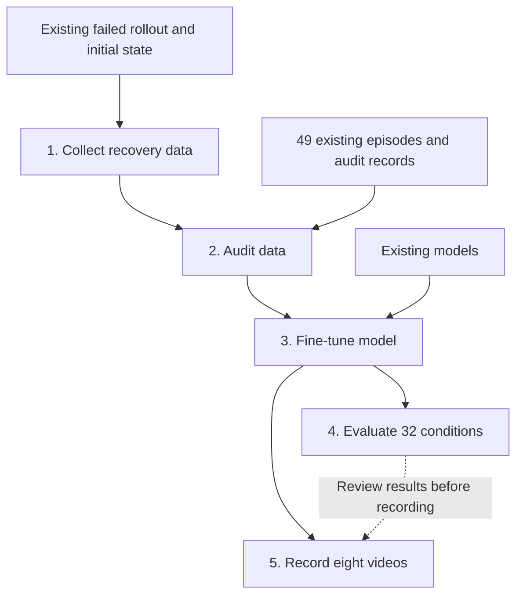

# code: Cube Grasping from Color-Based Language Instructions

This document describes the execution order, purpose, inputs, processing, and outputs of the five Python scripts in this directory.

The task is to select the cube specified by `pick up the red cube` or `pick up the blue cube`, grasp it, and hold it for three seconds. See the [project overview](../README_ENG.md) for the broader context.

> These five scripts cover the final improvement stage. They depend on 49 existing teacher episodes, a previously recorded failed rollout, and trained models. They are not a complete pipeline for collecting all data from scratch. They contain absolute paths from the original RunPod environment; standalone reproduction using only this repository has not been verified.

## 1. Execution Order and Purpose

| Order | Python script | Purpose | Main outputs |
|---|---|---|---|
| 1 | [collect_step5_color_replay_recovery_red1_v1.py](collect_step5_color_replay_recovery_red1_v1.py) | Reproduce a failed state and collect corrective teacher actions | Recovery HDF5 data and result JSON files |
| 2 | [audit_step5_color_replay_recovery_v1.py](audit_step5_color_replay_recovery_v1.py) | Audit the recovery data and combine its record with the existing dataset manifest | Training manifest and audit results |
| 3 | [train_step5_color_replay_recovery_v1.py](train_step5_color_replay_recovery_v1.py) | Fine-tune the VLA model using audited data | best.pt and model definitions |
| 4 | [evaluate_step5_color_replay_recovery32_v1.py](evaluate_step5_color_replay_recovery32_v1.py) | Evaluate the learned model under 32 conditions | Per-condition results and evaluation summary |
| 5 | [record_step5_color_portfolio8_v1.py](record_step5_color_portfolio8_v1.py) | Record eight videos: four quadrants × two instructions | MP4 videos and video manifest |



Steps 4 and 5 use the same model. Step 5 runs new simulations rather than reading the result files from Step 4. In the workflow, review the evaluation results before proceeding to recording.

To evaluate or record the published model only, you can skip Steps 1–3 and use the model restored by the [checkpoint restoration script](../result/models/restore_checkpoint.py). Dependencies such as the simulation environment and initial-state data are still required separately.

## 2. Inputs, Processing, and Outputs of Each Script

### 1. collect_step5_color_replay_recovery_red1_v1.py

**Purpose: Collect one episode of corrective teacher actions following the observation history of a previously failed rollout.**

The target condition is X=+20 mm, Y=−20 mm, layout `red_yminus_blue_yplus`, and instruction `pick up the red cube`. The layout name indicates that the red cube is on the negative-Y side and the blue cube is on the positive-Y side.

#### Input

- `episode.hdf5` from a previous failed evaluation: reset state, the first 500 actions, and end-effector, joint, and cube positions for replay verification.
- Initial-state data from the existing `lift_robomimic_language.hdf5` file for scene setup.
- Isaac Sim / Isaac Lab, assets for the Franka robot, cubes, and cameras, and runtime utilities such as `smoke_utils`.
- The target condition and instruction fixed in the source code. The outer script has no custom arguments for changing these conditions.

#### Processing

1. Set up an environment with two cubes and two cameras.
2. Verify the failed rollout's SHA256 and replay 500 actions from the saved state.
3. Compare end-effector, joint, and cube positions against the original recording. Stop if the differences exceed the tolerances.
4. From that state, execute the teacher sequence: approach → descend → close the gripper → lift.
5. Save **the images and robot state before each action, paired with the corresponding teacher action**.
6. Check lifting, three-second holding, movement of the non-target cube, and other criteria.

The teacher controller uses cube coordinates from the simulator. These coordinates are used for teacher-data generation and are distinct from the inputs to the VLA model.

#### Output

Output directory: `/workspace/step5/color_teacher_replay_red1_<generated_suffix>/`

| Output | Contents |
|---|---|
| Per-condition `episode.hdf5` | Observations, teacher actions, language instruction, and diagnostics |
| `recovery_context/obs` inside HDF5 | Observations from the 500 replay steps, used to warm up the GRU state |
| `recovery_context/replayed_actions` inside HDF5 | Replayed actions; not used as supervised teacher labels |
| `data/demo_0/obs` and `actions` inside HDF5 | Observations and teacher actions from the corrective segment |
| Per-condition `replay_check.json` and `result.json` | Replay differences and pass/fail results |
| `results.json` and `collection_summary.json` | Result list and summary |
| `frames/*.png` and `final_*.png` | Intermediate and final images |
| `collect_color_teacher.py`, `console.log`, and `share_results.txt` | Generated worker script, log, and results for sharing |

Failed collection runs are retained for diagnosis with `training_eligible=false`. The corrective teacher segment used in the published result contained 565 steps; this was an observed run length, not a fixed value.

### 2. audit_step5_color_replay_recovery_v1.py

**Purpose: Validate the recovery data and create a training manifest containing 50 episodes, including the 49 existing episodes.**

#### Input

- The existing 49-episode `training_manifest.json`, the `audit_results.json` in the same directory, and the referenced HDF5 files.
- The output directory from Step 1, including `results.json`, recovery HDF5 data, PNG images, `result.json`, and the generated `collect_color_teacher.py`.
- The original failed-rollout HDF5 file and its expected SHA256.

#### Processing

1. Check that the previous audit passed, confirm the episode count, and verify each dataset's SHA256.
2. Inspect the collection worker's syntax to confirm that observation capture and action recording occur before `env.step(action)`.
3. Validate image, state, and action shapes, sample counts, finite values, orientation conventions, and consistency between instructions and tokens.
4. Check teacher phase order, gripper commands, holding behavior, non-target cube movement, and agreement between PNG and HDF5 images.
5. Verify replay length, agreement between replayed and original actions, state differences, and the handoff position where teacher control begins.
6. Mark the existing 49 episodes as `standard` and the new episode as `recovery`, and create comparison images.

#### Output

Output directory: `/workspace/step5/color_replay_recovery_audit_<generated_suffix>/`

| Output | Contents |
|---|---|
| `training_manifest.json` | Created on success: references to 50 episodes, SHA256 values, episode roles, and replay-context handling |
| `audit_results.json` | Audit status, differences, counts, and error information |
| `recovery_comparison.png` and per-condition PNG images | Comparison panels showing replay history and teacher actions |
| `share_results.txt` | Audit summary |

The manifest is **a list of references to individual data files**, not a merged HDF5 file. Visual review is separate from automated checks; the output records `visual_review` as `pending recovery image`.

### 3. train_step5_color_replay_recovery_v1.py

**Purpose: Fine-tune the language-conditioned VLA model offline using audited data. This script does not run the simulator.**

#### Input

- `--manifest`: the `training_manifest.json` from Step 2 (required).
- The `audit_results.json` in the same directory and all 50 referenced HDF5 files.
- The previous baseline model `candidate.pt` and the fine-tuning initialization checkpoint `color_train_range20_6c624z6h/best.pt`. Their paths and expected SHA256 values are specified in the code.
- `--epochs`: maximum number of epochs; defaults to 300.
- A CUDA-capable GPU and a training environment including PyTorch.

| Training information | Contents |
|---|---|
| Images | RGB images from the table and wrist cameras, each 200×200 pixels |
| State | End-effector position (3), orientation in xyzw order (4), and two finger positions (2): 9 components |
| Language | Tokens for the instruction specifying the red or blue cube |
| Target action | Relative translation (3), relative rotation (3), and gripper command (1): 7 components |

#### Processing

1. Verify audit success, dataset composition, SHA256 values, and model formats.
2. Use 45 standard episodes plus one recovery episode for training, and the four episodes at X=0 mm, Y=+10 mm for validation: **46 training episodes and four validation episodes**.
3. Load the existing models and compute image features with the ResNet18 visual encoder frozen.
4. Fine-tune the model that combines visual, language, and state features and predicts actions using a temporal GRU.
5. For the recovery episode, use 500 observations to warm up the GRU's hidden state. **Compute supervised loss only on the corrective teacher segment**, with no loss or gradients computed over the replay context.
6. Save the model when validation loss improves. With the default settings, training runs for up to 300 epochs; from epoch 50 onward, early stopping applies if the best result has not improved for 40 epochs.

Cube coordinates and teacher phase indices are not model inputs. The outer script's custom arguments are `--manifest` and `--epochs`.

#### Output

Output directory: `/workspace/step5/color_train_replay_recovery_<generated_suffix>/`

| Output | Contents |
|---|---|
| `best.pt` | Model with the best validation loss among trained epochs, together with configuration information |
| `color_model.py` | Model definition for combining visual, language, and state information |
| `color_temporal.py` | Temporal GRU action-decoder definition |
| `training_protocol.json` | Data split, inputs, training settings, and replay-context handling |
| `metrics.jsonl` | Per-epoch loss and validation metrics |
| `training_summary.json` | Training results, including the best epoch |
| `train_worker.py` and `console.log` | Worker script and log |

Validation loss measures agreement with teacher actions. Actual grasping and holding performance is checked in Step 4.

### 4. evaluate_step5_color_replay_recovery32_v1.py

**Purpose: Control the robot using only the selected learned model and evaluate target-color grasping and three-second holding under 32 conditions.**

#### Input

- `--checkpoint`: the `best.pt` to evaluate; defaults to the absolute path of the original selected model.
- `color_model.py` and `color_temporal.py` in the same directory as the checkpoint.
- Initial-state data, the Isaac Lab environment, assets, and runtime dependencies.
- Images from two cameras, the nine-dimensional robot state observed at each step, and the language instruction.

#### Processing

1. Verify the SHA256 values of the checkpoint and model definitions.
2. Reset the environment for each of the following 32 conditions and reset the GRU state at the start of each trial.
3. Predict seven-dimensional actions from observations and instructions, executing them in a closed loop where each action's outcome becomes the next observation.
4. Check lifting, holding, non-target cube movement, joint limits, and other criteria.
5. Verify the language-processing and action-inference call counts at each step, then save the results.

| Condition | Details |
|---|---|
| Eight positions | Axial: (-20,0), (20,0), (0,-20), (0,20); diagonal: (-20,-20), (-20,20), (20,-20), (20,20). Units: mm |
| Two color layouts | Red on the negative-Y side and blue on the positive-Y side, plus the swapped layout |
| Two instructions | Select the red cube or select the blue cube |
| Total | 8 positions × 2 layouts × 2 instructions = 32 trials |

The offsets translate both cubes together, maintaining a 120 mm separation. Evaluation does not switch to teacher control or override actions with teacher commands.

#### Output

Output directory: `/workspace/step5/color_policy_replay_recovery32_<generated_suffix>/`

- `results.json`: individual results for the 32 conditions.
- `collection_summary.json`: overall and per-position success counts and other summary information.
- `collection_protocol.json`: evaluation conditions.
- Per-condition `result.json` and `episode.hdf5`: pass/fail results, states, actions, and diagnostics such as cube positions.
- `frames/*.png` and `final_*.png`: intermediate and final images.
- `evaluate_color_policy.py`, `console.log`, and `share_results.txt`: worker script, log, and results for sharing.

The evaluation HDF5 does not store camera images at every step; selected images are saved as PNG files instead. It is marked `training_eligible=false` and should not be treated as the same training-data format as the teacher data from Step 1.

### 5. record_step5_color_portfolio8_v1.py

**Purpose: Run eight new trials with the selected model and create demonstration videos with instruction captions.**

#### Input

- The same `best.pt` as in Step 4 and the two model-definition files in its directory.
- The same initial-state data, simulation environment, assets, and runtime dependencies as Step 4.
- An ffmpeg executable provided by `ffmpeg` or `imageio_ffmpeg`, with the `libx264` encoder available.
- The `--checkpoint` argument; defaults to the original selected model's path.

#### Processing

1. Validate the model and set the four diagonal positions: (+20,+20), (-20,+20), (-20,-20), and (+20,-20) mm.
2. Fix the color layout to `red_yminus_blue_yplus` and run both red and blue instructions at each position, for eight trials in total.
3. Run closed-loop control with the model and apply the same success criteria as Step 4.
4. Place the table-camera view on the left and the wrist-camera view on the right, add the English instruction below them, and save 800×464-pixel MP4 videos.

This script **reruns the simulation while recording**; it does not convert Step 4's records into videos.

#### Output

Output directory: `/workspace/step5/color_portfolio_video8_<generated_suffix>/`

| Output | Contents |
|---|---|
| `portfolio.mp4` in each condition directory | Video with an instruction caption; eight videos after all eight trials complete |
| `video_manifest.json` | Video paths, positions, instructions, and pass/fail results |
| `results.json` and `collection_summary.json` | Results and summary for the eight trials |
| Per-condition `episode.hdf5`, `result.json`, and PNG files | State, action, diagnostic, and image records |
| `portfolio.ffmpeg.log`, `console.log`, and `share_results.txt` | Encoding log, execution log, and results for sharing |

Names such as `q1_red.mp4` are used for the published videos. The script itself writes `portfolio.mp4` inside each condition directory.

## 3. Files Passed Between Steps and Execution Notes

Newly generated output paths are not automatically configured in the next script.

| Location | What to check or configure |
|---|---|
| `replay_path` in Step 1's worker | Source failed-rollout HDF5 and its SHA256 |
| `OLD_MANIFEST` in Step 2 | Audited manifest for the existing 49 episodes |
| `NEW_ROOT` in Step 2 | Recovery-data directory generated by Step 1 |
| `SOURCE` and `SOURCE_SHA` in Step 2 | The same replay-source HDF5 and SHA256 used in Step 1 |
| `--manifest` in Step 3 | Manifest generated by Step 2 |
| `baseline_path` and `warm_path` in Step 3's worker | Baseline and fine-tuning initialization checkpoints; SHA256 checks apply |
| `--checkpoint` in Steps 4 and 5 | Selected model; the two model-definition files must be in the same directory |
| Shared environment paths | `/workspace/step4`, `/workspace/IsaacLab-develop`, initial-state data, runtime dependencies, assets, etc. |

**Steps 4 and 5 do not accept arbitrary retrained models without changes.** Although `--checkpoint` lets you change the file location, the expected checkpoint SHA256 is fixed to the published selected model:

```text
20b61d3e9167321aeb5f72e1fd9fecf32f7afd080d5510fa4f6b5fd7e37d3d11
```

If rerunning Step 3 produces a checkpoint with a different SHA256, Steps 4 and 5 stop with `Trained checkpoint changed`. To evaluate another model, verify the checkpoint and its accompanying definitions, then manage the expected hash in the code accordingly.

Collection, evaluation, and recording generate worker scripts internally and launch Isaac Lab in headless mode with cameras enabled on `cuda:0`. The actual output directories are printed under labels such as `RUN_DIRECTORY`, `AUDIT_DIRECTORY`, and `TRAINING_DIRECTORY`.

The full teacher-image dataset and training HDF5 files are not included in this repository. See the [dataset publication scope](../datasets/README.md).

## 4. Success Criteria and Published Results

Steps 4 and 5 combine the following main criteria:

- The target cube is lifted at least 100 mm above its starting height.
- The gripper is commanded closed, and the end effector is within 80 mm of the target cube.
- These conditions hold for 10 consecutive steps, followed by a further three-second hold check.
- The non-target cube's maximum lift is less than 20 mm and its XY displacement is at most 10 mm.
- The target cube's maximum XY displacement is at most 50 mm, and joint limits remain within the allowed tolerance.

The published selected model passed [32/32 evaluation trials](../result/evidence/range20_results.json) and [8/8 video-recording trials](../result/evidence/video_results.json).

These are regression evaluations at fixed conditions, including positions used for training and recovery. They do not establish general performance at unseen positions, success rates over repeated trials, contact-force-based grasp verification, or real-robot performance.

## 5. Related Resources

- [Project README](../README_ENG.md)
- [Dataset contents and publication scope](../datasets/README.md)
- [Checkpoint restoration script](../result/models/restore_checkpoint.py)
- [Visual, language, and state model definition](../result/models/color_model.py)
- [Temporal action-decoder definition](../result/models/color_temporal.py)

This document describes the five Python scripts on the main branch reviewed on October 24, 2026.
