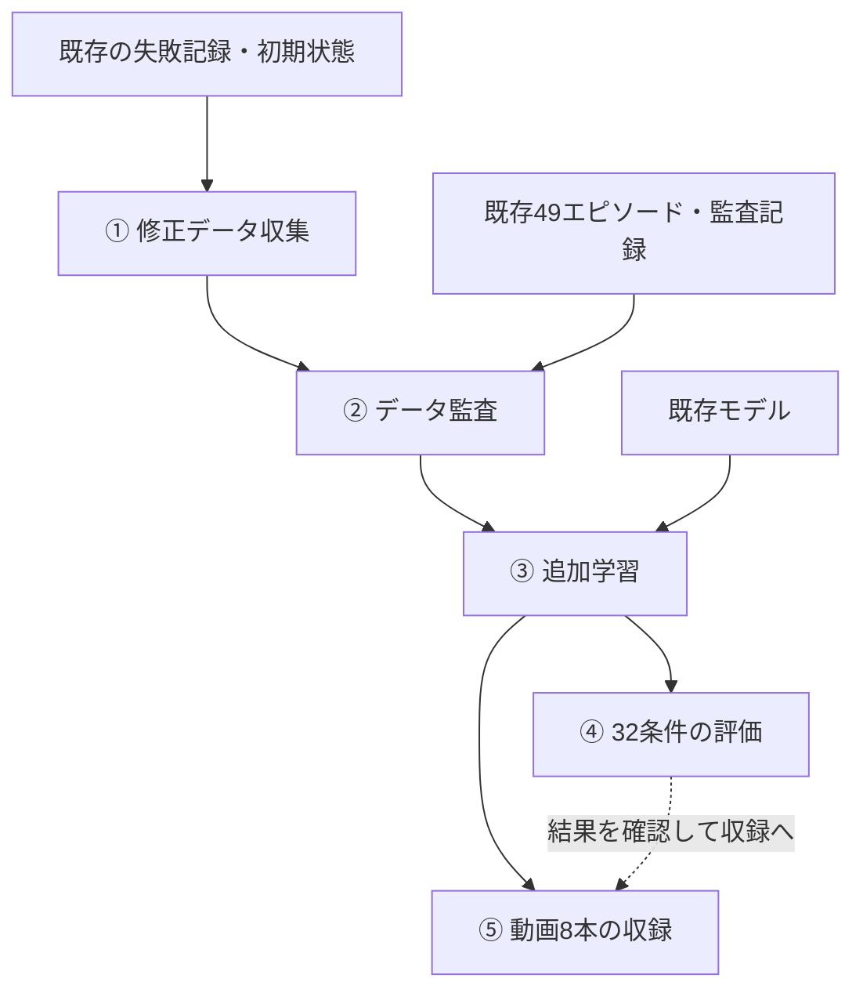

# code：色の言語指示に応じたCube把持の実行コード

このディレクトリの5つのPythonコードについて、使用順序、利用目的、input（入力）・処理・output（出力）を説明します。

対象タスクは、`pick up the red cube` / `pick up the blue cube` の指示に応じてCubeを選択し、把持して3秒間保持することです。[プロジェクト全体の説明](../README_JPN.md) も参照してください。

> この5本は、既存の教師データ49エピソード、過去の失敗記録、学習済みモデルを前提とした、最終改善工程のコードです。全データの初回収集から行う一式ではありません。元のRunPod環境への絶対パスが含まれ、リポジトリ単独での再実行は未検証です。

## 1. 使用する順番と利用目的

| 順番 | Pythonコード | 利用目的 | 主な出力 |
|---|---|---|---|
| ① | [collect_step5_color_replay_recovery_red1_v1.py](collect_step5_color_replay_recovery_red1_v1.py) | 失敗状態を再現し、教師の修正動作を収集する | 修正データのHDF5、結果JSON |
| ② | [audit_step5_color_replay_recovery_v1.py](audit_step5_color_replay_recovery_v1.py) | 修正データを監査し、既存データと統合する | 学習用マニフェスト、監査結果 |
| ③ | [train_step5_color_replay_recovery_v1.py](train_step5_color_replay_recovery_v1.py) | 監査済みデータでVLAモデルを追加学習する | best.pt、モデル定義 |
| ④ | [evaluate_step5_color_replay_recovery32_v1.py](evaluate_step5_color_replay_recovery32_v1.py) | 学習モデルを32条件で評価する | 条件別結果、評価要約 |
| ⑤ | [record_step5_color_portfolio8_v1.py](record_step5_color_portfolio8_v1.py) | 4象限×2指示の動画8本を収録する | MP4動画、動画一覧 |



④と⑤は同じモデルを使います。⑤は④の結果ファイルを読み込むのではなく、シミュレーションを新しく実行します。作業としては④で成否を確認してから⑤へ進みます。

公開モデルの評価・収録だけを行う場合は、①〜③を省略し、[モデル復元コード](../result/models/restore_checkpoint.py) で復元したモデルを利用できます。ただし、シミュレーション環境や初期状態データ等の依存物は別途必要です。

## 2. 各コードのinput・処理・output

### ① collect_step5_color_replay_recovery_red1_v1.py

**利用目的：過去の失敗時の観測履歴に続く、教師の修正動作を1エピソード収集します。**

対象条件は、X=+20 mm、Y=−20 mm、色配置 `red_yminus_blue_yplus`、指示 `pick up the red cube` です。配置名は赤CubeがYマイナス側、青CubeがYプラス側にあることを表します。

#### input（入力）

- 過去の失敗評価の `episode.hdf5`：リセット状態、最初の500ステップの行動、再現確認用の手先・関節・Cube位置。
- シーン構築用の既存データ `lift_robomimic_language.hdf5` の初期状態。
- Isaac Sim / Isaac Lab、Franka・Cube・カメラ等のアセット、`smoke_utils` 等のランタイム。
- コード内に固定された対象条件と指示文。外側のスクリプトに条件変更用の独自引数はありません。

#### 処理

1. 2個のCubeと2台のカメラを持つ環境を準備します。
2. 失敗記録のSHA256を確認し、保存状態から500ステップの行動を再生します。
3. 手先・関節・Cube位置を元の記録と比較します。許容誤差を超えた場合は中止します。
4. その状態から教師制御で「接近 → 下降 → 閉じる → 持ち上げる」を実行します。
5. **動作前の画像・ロボット状態と、その時点の教師の正解動作**を保存します。
6. 持ち上げ・3秒保持・指定外Cubeの動き等を判定します。

教師制御はシミュレータ内のCube座標を使います。これは教師データ生成用の情報であり、VLAモデルへの入力とは区別されます。

#### output（出力）

出力先：`/workspace/step5/color_teacher_replay_red1_<自動生成文字列>/`

| 出力 | 内容 |
|---|---|
| 条件別の `episode.hdf5` | 観測、正解動作、言語指示、診断情報 |
| `recovery_context/obs`（HDF5内） | 再生した500ステップの観測。GRUの履歴準備に使用 |
| `recovery_context/replayed_actions`（HDF5内） | 再生行動。教師の正解ラベルには使用しない |
| `data/demo_0/obs`・`actions`（HDF5内） | 教師の修正区間の観測と正解動作 |
| 条件別の `replay_check.json`、`result.json` | 再現誤差、成否 |
| `results.json`、`collection_summary.json` | 結果一覧と要約 |
| `frames/*.png`、`final_*.png` | 途中・最終状態の画像 |
| `collect_color_teacher.py`、`console.log`、`share_results.txt` | 生成したworkerコード、ログ、共有用結果 |

失敗した収集結果は診断用として残し、`training_eligible=false` とします。公開成果で使用した教師の修正区間は565ステップですが、この長さは実行結果であり固定値ではありません。

### ② audit_step5_color_replay_recovery_v1.py

**利用目的：修正データを検査し、既存49件と合わせた50エピソードの学習一覧を作成します。**

#### input（入力）

- 既存49件の `training_manifest.json`、同じフォルダーの `audit_results.json`、参照されるHDF5。
- ①の出力フォルダー、`results.json`、修正HDF5・PNG・`result.json`、生成された `collect_color_teacher.py`。
- 再生元の失敗HDF5と、指定されたSHA256。

#### 処理

1. 既存監査の合格状態、件数、各データのSHA256を確認します。
2. 収集workerの構文を調べ、観測取得・行動保存が `env.step(action)` より前にあることを確認します。
3. 画像・状態・行動の形状、件数、有限値、姿勢表現、指示とトークンの一致を検査します。
4. 教師の工程順序、開閉指令、保持、指定外Cubeの動き、PNGとHDF5画像の一致等を検査します。
5. 再生履歴の長さ、再生行動と元記録の一致、状態誤差、教師への引継ぎ位置を確認します。
6. 既存49件を `standard`、修正1件を `recovery` として一覧化し、比較画像を作成します。

#### output（出力）

出力先：`/workspace/step5/color_replay_recovery_audit_<自動生成文字列>/`

| 出力 | 内容 |
|---|---|
| `training_manifest.json` | 合格時に作成する50件の参照一覧、SHA256、役割、再生履歴の扱い |
| `audit_results.json` | 検査の成否、誤差、件数、エラー情報 |
| `recovery_comparison.png`、条件別PNG | 再生履歴と教師動作を確認する比較画像 |
| `share_results.txt` | 監査結果の要約 |

マニフェストは結合したHDF5ではなく、**各データファイルへの参照一覧**です。画像の目視確認は機械的検査とは別で、出力の `visual_review` は `pending recovery image` と記録されます。

### ③ train_step5_color_replay_recovery_v1.py

**利用目的：監査済みデータで、言語条件付きVLAをオフライン追加学習します。シミュレーションは実行しません。**

#### input（入力）

- `--manifest`：②の `training_manifest.json`（必須）。
- 同じフォルダーの `audit_results.json`、参照される50件のHDF5。
- 過去の基準モデル `candidate.pt` と、追加学習開始モデル `color_train_range20_6c624z6h/best.pt`。パス・SHA256はコード内で指定されています。
- `--epochs`：最大エポック数。省略時は300。
- CUDA対応GPUとPyTorch等の学習環境。

| 学習に使用する情報 | 内容 |
|---|---|
| 画像 | テーブル・手首の2台のRGB画像。各200×200ピクセル |
| 状態 | 手先位置3成分、姿勢4成分（xyzw）、左右の指位置2成分、計9成分 |
| 言語 | 赤・青を指定する指示文のトークン |
| 正解動作 | 相対移動3成分、相対回転3成分、グリッパー開閉1成分、計7成分 |

#### 処理

1. 監査合格、データ構成、SHA256、モデル形式を確認します。
2. 通常45件＋修正1件を学習用、X=0 mm・Y=+10 mmの4件を検証用に分割します。**学習46件・検証4件**です。
3. 既存モデルを読み込み、ResNet18の画像特徴抽出器を固定して画像特徴を計算します。
4. 画像・言語・状態の特徴を統合し、時間方向GRUで動作を予測するモデルを追加学習します。
5. 修正エピソードでは500ステップの観測でGRUの内部状態を準備し、**教師の修正区間だけを損失計算の対象**にします。再生区間では損失・勾配を計算しません。
6. 検証損失が改善したモデルを保存します。既定設定では最大300エポック、50エポック以降は最良値の更新が40エポックない場合に早期終了します。

Cube座標や教師の工程番号はモデルへ入力しません。外側のスクリプトの独自引数は `--manifest` と `--epochs` です。

**GRUとは：** GRU（Gated Recurrent Unit）は、過去の情報を内部状態として保持し、時系列データを扱うニューラルネットワークです。本実装の時間方向GRUは、画像・言語・ロボット状態から得た特徴を順に受け取り、過去の観測も踏まえて次の動作を予測します。

**追加学習の手法：** 既存モデルを初期値とした模倣学習（Behavioral Cloning）によるファインチューニングです。画像特徴抽出器（ResNet18）は固定し、言語・状態の処理、特徴の統合、時間方向GRUなどを更新します。教師動作との誤差を、移動・回転にはSmooth L1損失、グリッパー開閉には二値交差エントロピー損失で評価し、AdamWで最適化します。修正データの再生履歴500ステップはGRUの内部状態の準備にのみ使い、後続の教師動作を学習対象にします。

#### output（出力）

出力先：`/workspace/step5/color_train_replay_recovery_<自動生成文字列>/`

| 出力 | 内容 |
|---|---|
| `best.pt` | 学習中の検証損失が最良だったモデルと設定情報 |
| `color_model.py` | 画像・言語・状態を統合するモデル定義 |
| `color_temporal.py` | 時間方向GRUの動作デコーダ定義 |
| `training_protocol.json` | 分割、入力、学習条件、再生履歴の扱い |
| `metrics.jsonl` | エポックごとの損失・検証指標 |
| `training_summary.json` | 最良エポック等の学習結果 |
| `train_worker.py`、`console.log` | workerコードとログ |

検証損失は教師動作との一致を評価する指標です。実際の把持・保持の成否は④で確認します。

### ④ evaluate_step5_color_replay_recovery32_v1.py

**利用目的：採用モデルだけでロボットを動かし、32条件で指定色の把持・3秒保持を評価します。**

#### input（入力）

- `--checkpoint`：評価する `best.pt`。省略時は元の採用モデルの絶対パス。
- 同じフォルダーの `color_model.py`、`color_temporal.py`。
- 初期状態データ、Isaac Lab環境、アセット、ランタイム。
- 毎ステップ取得する2台の画像・9次元状態と、指示文。

#### 処理

1. モデル本体とモデル定義のSHA256を検証します。
2. 下記32条件で環境をリセットし、試行ごとにGRUの履歴を初期化します。
3. 観測と指示から7次元動作を予測し、実行結果を次の観測へ戻す閉ループ制御を行います。
4. 持ち上げ・保持、指定外Cubeの移動、関節制限等を判定します。
5. 毎ステップの言語処理・行動推論の実行回数も確認し、結果を保存します。

| 条件 | 内容 |
|---|---|
| 位置8通り | 軸方向 (-20,0), (20,0), (0,-20), (0,20)、対角方向 (-20,-20), (-20,20), (20,-20), (20,20)。単位mm |
| 色配置2通り | 赤がYマイナス側・青がYプラス側、その入替え |
| 指示2通り | 赤Cubeを指定、青Cubeを指定 |
| 合計 | 8位置 × 2配置 × 2指示 = 32試行 |

オフセットは2個のCubeを一緒に平行移動する値で、Cube間隔は120 mmです。教師制御への切替や教師動作による上書きは行いません。

#### output（出力）

出力先：`/workspace/step5/color_policy_replay_recovery32_<自動生成文字列>/`

- `results.json`：32条件の個別結果。
- `collection_summary.json`：全体・位置別の成功数等。
- `collection_protocol.json`：評価条件。
- 条件別の `result.json`、`episode.hdf5`：成否、状態、行動、Cube位置等の診断記録。
- `frames/*.png`、`final_*.png`：途中・最終状態の画像。
- `evaluate_color_policy.py`、`console.log`、`share_results.txt`：workerコード、ログ、共有用結果。

評価HDF5には毎ステップのカメラ画像を保存せず、画像は間引いたPNG等として保存します。`training_eligible=false` であり、①の教師データと同じ学習用形式としては扱いません。

### ⑤ record_step5_color_portfolio8_v1.py

**利用目的：採用モデルで8試行を新しく実行し、指示文付きのデモ動画を作成します。**

#### input（入力）

- ④と同じ `best.pt` と、同じフォルダーのモデル定義2ファイル。
- ④と同じ初期状態データ、シミュレーション環境、アセット、ランタイム。
- `ffmpeg` または `imageio_ffmpeg` のffmpeg実行ファイル。`libx264` エンコーダが必要です。
- `--checkpoint` 引数。省略時は元の採用モデルのパス。

#### 処理

1. モデル等を検証し、4象限の対角位置 (+20,+20), (-20,+20), (-20,-20), (+20,-20) mmを設定します。
2. 色配置を `red_yminus_blue_yplus` に固定し、各位置で赤・青の指示を実行します。合計8試行です。
3. モデルで閉ループ制御を行い、④と同じ基準で成否を判定します。
4. テーブルカメラを左、手首カメラを右に並べ、下部に英文指示を付けた800×464ピクセルの映像をMP4に保存します。

④の記録を動画へ変換するコードではなく、**シミュレーションを再実行して収録するコード**です。

#### output（出力）

出力先：`/workspace/step5/color_portfolio_video8_<自動生成文字列>/`

| 出力 | 内容 |
|---|---|
| 各条件フォルダーの `portfolio.mp4` | 指示文付き動画。8試行完了時に8本 |
| `video_manifest.json` | 動画パス、位置、指示、成否の一覧 |
| `results.json`、`collection_summary.json` | 8試行の結果と要約 |
| 条件別の `episode.hdf5`、`result.json`、PNG | 状態・行動・診断・画像の記録 |
| `portfolio.ffmpeg.log`、`console.log`、`share_results.txt` | エンコードログ、実行ログ、共有用結果 |

公開動画の `q1_red.mp4` 等は公開用の名前です。このコードが直接作る動画名は、各条件フォルダー内の `portfolio.mp4` です。

## 3. 工程間で渡すファイルと実行上の注意

新しい出力先が次のコードへ自動設定されるわけではありません。

| 箇所 | 確認・設定する内容 |
|---|---|
| ①のworker内 `replay_path` | 再生元の失敗HDF5とSHA256 |
| ②の `OLD_MANIFEST` | 既存49件の監査済みマニフェスト |
| ②の `NEW_ROOT` | ①で生成された修正データのフォルダー |
| ②の `SOURCE`・`SOURCE_SHA` | ①と同じ再生元HDF5とSHA256 |
| ③の `--manifest` | ②で生成されたマニフェスト |
| ③のworker内 `baseline_path`・`warm_path` | 基準モデル・追加学習開始モデル。SHA256検査あり |
| ④・⑤の `--checkpoint` | 採用モデル。同じフォルダーにモデル定義2ファイルが必要 |
| 共通の環境パス | `/workspace/step4`、`/workspace/IsaacLab-develop`、初期状態データ、ランタイム、アセット等 |

**④・⑤は任意の再学習モデルをそのまま受け付ける実装ではありません。** `--checkpoint` で場所は変更できますが、モデル本体のSHA256は公開採用モデルの次の値に固定されています。

```text
20b61d3e9167321aeb5f72e1fd9fecf32f7afd080d5510fa4f6b5fd7e37d3d11
```

③を再実行して異なるSHA256のモデルが生成された場合、④・⑤は `Trained checkpoint changed` で停止します。別モデルを評価する場合は、モデルと付属定義を確認した上で、コード内の期待値もそのモデルに合わせて管理する必要があります。

収集・評価・収録は内部でworkerを生成し、Isaac Labをヘッドレス・カメラ有効・`cuda:0` で起動します。実際の出力先は `RUN_DIRECTORY`、`AUDIT_DIRECTORY`、`TRAINING_DIRECTORY` 等の表示で確認できます。

全教師画像データや学習用HDF5はこのリポジトリに同梱されていません。[データの公開範囲](../datasets/README.md) を参照してください。

## 4. 成功判定と公開結果

④・⑤では、主に次の条件を組み合わせて成功を判定します。

- 指定Cubeが開始位置から100 mm以上持ち上がっている。
- グリッパーが閉じる指令で、手先と指定Cubeの距離が80 mm以内である。
- 上記状態が10ステップ連続した後、さらに3秒の保持を確認する。
- 指定外Cubeの最大上昇が20 mm未満、XY移動が10 mm以内である。
- 指定Cubeの最大XY移動が50 mm以内で、関節制限の許容誤差内である。

公開採用モデルでは、[32条件の評価](../result/evidence/range20_results.json) が32/32成功、[動画収録](../result/evidence/video_results.json) が8/8成功でした。

これらは学習・修正に使用した位置を含む固定条件での回帰評価です。未知位置全般や繰り返し試行の成功率、接触力に基づく把持の保証、実機での性能を示すものではありません。

## 5. 関連資料

- [プロジェクト全体のREADME](../README_JPN.md)
- [データの内容と公開範囲](../datasets/README.md)
- [モデル復元コード](../result/models/restore_checkpoint.py)
- [画像・言語・状態のモデル定義](../result/models/color_model.py)
- [時間方向の動作デコーダ](../result/models/color_temporal.py)

本書は、2026年10月24日に確認したmainブランチの5つのPythonコードに基づく説明です。
